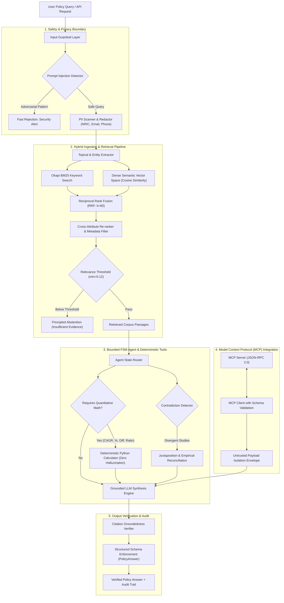
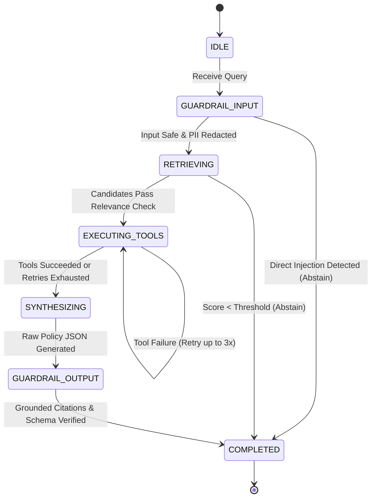
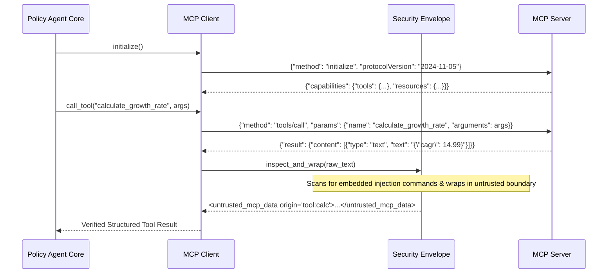

# Architecture & Technical Design: Evidence-Grounded Policy Research Assistant

## 1. Executive Summary & Design Philosophy
The **Evidence-Grounded Policy Research Assistant** is engineered for public sector policy analysts and economic researchers who synthesize multi-source government statistics, regulatory frameworks, and strategy whitepapers. 

The system prioritizes **grounded truth, verifiable citations, deterministic computation, and responsible AI guardrails** over superficial generation fluency. It replaces unconstrained LLM hallucinations with a bounded, observable Finite State Machine (FSM) architecture integrated with the standard Model Context Protocol (MCP).

---

## 2. End-to-End System Architecture



---

## 3. Data Flow & Subsystem Breakdown

### 3.1 Input Guardrail Subsystem
- **Direct Prompt Injection Guard:** Employs regex heuristic automata and instruction boundary checks to detect jailbreak payloads (e.g., `DAN`, `Ignore previous instructions`, `Developer Mode`).
- **Privacy & PII Redactor:** Uses compiled regex recognizers for Singapore National Registration Identity Card (NRIC/FIN: `[STFGM]\d{7}[A-Z]`), Singapore phone numbers (`+65 6/8/9...`), and sensitive enterprise API tokens, redacting them to `[REDACTED_CONFIDENTIAL]` before ingestion into retrieval or reasoning layers.

### 3.2 Ingestion & Hybrid Retrieval Pipeline
- **Mixed-Format Corpus:**
  - *Structured Tables:* Ingests tabular CSVs (Macro digital indicators, tech workforce wage distributions, SME adoption surveys) and transforms rows into semantically enriched relational blocks preserving provenance headers.
  - *Unstructured Whitepapers:* Ingests markdown/text policy reports (`SG-DER-2024`, `SG-NAIS-2023`, `SG-PDPC-AI-2024`, `SG-WORKFORCE-DISPUTE-2024`), segmenting by structural sections (`## Section Heading`) and word-bounded sliding windows.
- **Dual-Track Retrieval:**
  - *Okapi BM25:* Deterministic inverse document frequency with Robertson-Spärck Jones weighting ($k_1=1.5, b=0.75$) and domain stopword filtering.
  - *Dense Semantic Retrieval:* Subword n-gram vector projection with L2 normalization and continuous cosine similarity matrix dot products.
  - *Reciprocal Rank Fusion (RRF):*
    $$\text{RRF}(d) = \sum_{m \in \{\text{BM25}, \text{Dense}\}} \frac{1}{60 + \text{rank}_m(d)}$$
  - *Re-ranking & Strict Abstention:* Evaluates substantive keyword coverage (excluding meta-instruction verbs like *calculate*, *query*, *synthesize*). If substantive term coverage is $< 40\%$ or relevance score $< 0.12$, candidates are pruned, triggering principled abstention.

### 3.3 Bounded Agentic Workflow (Finite State Machine)
Rather than deploying autonomous, non-deterministic multi-agent swarms, the system implements a **bounded, single-agent Finite State Machine (FSM)**:



#### Deterministic Tool Execution Policy:
- **No LLM Arithmetic:** The LLM is explicitly forbidden from performing CAGR, percentages, ratios, or subtraction in prompt space.
- All calculations are delegated to the `DeterministicCalculator` in Python, returning a cryptographically verifiable `CalculationStep` containing:
  - Exact human-readable expression
  - Raw inputs and provenance
  - Deterministic floating-point result formatted with correct units.

### 3.4 Model Context Protocol (MCP) Architecture
The system integrates a compliant MCP server (`src/mcp/server.py`) and protocol client (`src/mcp/client.py`) implementing JSON-RPC 2.0:



---

## 4. Security & Trust Boundaries

| Boundary | Threat Vector | Mitigation Mechanism |
| :--- | :--- | :--- |
| **Ingress Boundary** | Direct Prompt Injection & Jailbreaks | Regex pattern matching against known override tokens; canary token validation. |
| **Privacy Boundary** | PII / Confidential Data Leaks | Pre-retrieval redaction of Singapore NRIC, phone numbers, emails, and credentials. |
| **Retrieval Boundary** | Indirect Data Poisoning in Corpus | Sanitization of delimiter tags (`<script>`, ````system```) and post-retrieval injection scan. |
| **Tool Execution Boundary** | Unsafe Code Execution (`eval`/OS commands) | Pure deterministic Python functions with strict Pydantic input schemas; zero arbitrary shell invocation. |
| **MCP Integration Boundary** | Malicious / Compromised MCP Servers | Isolation of all MCP outputs inside `<untrusted_mcp_data>` tags; explicit user confirmation for write operations. |
| **Generation Boundary** | Number / Citation Hallucination | Groundedness audit requiring token quote overlap $\ge 70\%$; Pydantic schema validation. |

---

## 5. Technology Stack & Architectural Justification

- **Language:** Python 3.14 (pinned dependencies)
- **Data Validation & Schemas:** Pydantic v2 (enforces strict typing, field invariants, and programmatic JSON serialization)
- **Protocol Interoperability:** Model Context Protocol (MCP v2.3.0) via JSON-RPC 2.0
- **Vector & Matrix Operations:** NumPy (cosine similarity dot products, L2 normalization)
- **Structured Data Processing:** Pandas (data quality audit, missing value checks, tabular pivots)
- **Testing & Verification:** Pytest (32 automated unit, integration, and scenario tests)
- **CLI & Visualization:** Rich & Tabulate (colorized telemetry, ASCII trend charts, and structured tables)
- **API Engine:** FastAPI & Uvicorn (lightweight RESTful endpoints with OpenAPI/Swagger documentation)
